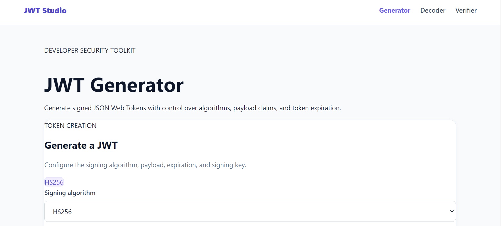

# 🔐 JWT Studio

**A full-stack JWT generator, decoder & verifier — built with security-conscious defaults, structured errors, and a tested API.**


JSON Web Tokens are easy to generate and easy to misuse. JWT Studio is a focused tool
that makes the difference between **decoding** and **verifying** explicit — supporting
HS256, RS256, ES256 and PS256, with allowlisted algorithms, input validation, and audit
logging that never persists tokens or keys.

> 🔗 **Live demo:** _[add link after deployment]_
> 📸 **Screenshot:** `assets/images/jwtpreview.png`


<!-- 📸 Replace with a screenshot or short GIF of the generator + verifier UI -->

---

## ✨ Features

### JWT Generator
- Sign tokens with **HS256, RS256, ES256 or PS256**
- Configure custom payloads and expiration
- Input validated with Zod before processing

### JWT Decoder
- Inspect header and payload claims
- Clearly labelled as **decoding only — not proof of authenticity**

### JWT Verifier
- Verify signatures using the correct key per algorithm
- Reject invalid, expired or tampered tokens
- Explicit algorithm allowlisting on verification

### Security & Reliability
- Zod-validated request bodies
- `jose` for all JWT operations
- HMAC key-length validation
- Helmet security headers
- Configurable CORS
- Rate limiting per route
- Structured errors with request IDs
- Audit logging that excludes tokens, keys and full payloads

---

## 🧱 Tech Stack

| Layer | Technologies |
|-------|--------------|
| Frontend | React, Vite, React Router |
| API client | Axios |
| Backend | Node.js, Express |
| JWT operations | `jose` |
| Validation | Zod |
| Database | MongoDB, Mongoose |
| Security | Helmet, CORS, express-rate-limit |
| Unit & integration | Vitest, Supertest |
| Browser testing | Playwright |

---

## 🏗️ Architecture

```
React (Vite)  ──axios──►  Express API  ──jose──►  JWT operations
     ▲                        │
     │                        ├── Zod validation
     └──── /api/v1 ◄──────────┼── Rate limiting + Helmet
                              ├── Structured errors (request IDs)
                              └── MongoDB audit log (no secrets)
```

**Design principles**
- **Verify ≠ decode** — decoding never implies trust; verification always requires a key.
- **Allowlist, never infer** — verification accepts only explicitly permitted algorithms.
- **Validate at the edge** — Zod schemas guard every request before logic runs.
- **Log metadata, not secrets** — audit entries store operation info only.

---

## 📁 Project Structure

```
JWT Generator/
├── client/
│   └── src/
│       ├── app/
│       ├── components/
│       ├── hooks/
│       ├── pages/
│       ├── services/
│       └── utils/
├── server/
│   └── src/
│       ├── config/
│       ├── controllers/
│       ├── middleware/
│       ├── models/
│       ├── routes/
│       ├── schemas/
│       ├── services/
│       └── utils/
├── tests/
│   └── e2e/
├── playwright.config.js
├── vitest.config.js
└── README.md
```

---

## 🚀 Local Setup

### Requirements
- Node.js
- npm
- MongoDB connection
- Git (if cloning)

### Install dependencies

From the project root:

```bash
npm install
npm install --prefix client
npm install --prefix server
```

### Configure environment variables

Create `server/.env`:

```env
NODE_ENV=development
PORT=5000
CLIENT_URL=http://localhost:5173
DATABASE_URL=YOUR_MONGODB_CONNECTION_STRING
```

Create `client/.env`:

```env
VITE_API_BASE_URL=http://localhost:5000/api/v1
```

> ⚠️ Replace the Mongo placeholder with your own connection string.
> Never commit real credentials or signing keys.

### Run the application

```bash
npm run dev          # client + server together
```

Or run separately:

```bash
npm run server       # backend at http://localhost:5000
npm run client       # frontend at http://localhost:5173
```

---

## 📡 API Endpoints

Base path: `/api/v1`

| Method | Endpoint | Purpose |
|--------|----------|---------|
| `GET` | `/health` | Health check |
| `POST` | `/jwt/generate` | Generate a JWT |
| `POST` | `/jwt/decode` | Decode a JWT |
| `POST` | `/jwt/verify` | Verify a JWT |

**Response shape**

```json
// Success
{ "success": true, "data": { ... } }

// Error
{ "success": false, "error": { "code": "INVALID_TOKEN", "message": "...", "requestId": "..." } }
```

---

## 🧪 Testing

```bash
npm run test           # Vitest — unit + integration
npm run test:e2e       # Playwright — browser tests
npm run build --prefix client   # production build check
```

### Latest verified results

| Check | Result |
|-------|--------|
| Vitest | ✅ 118 tests passed across 6 files |
| Playwright | ✅ 6 tests passed |
| Vite production build | ✅ Successful |

> These results reflect development runs and do not guarantee every possible behaviour is covered.

---

## 🔒 Security Notes

- **Decoding does not verify a signature.** Verification requires the correct key.
- **Verification uses an explicit algorithm allowlist** — no algorithm is inferred from the token.
- **Signing secrets and private keys stay server-side** and must never be committed.
- **Audit logs store operation metadata only** — never JWTs, keys or full payloads.
- **Production requires** a configured frontend API URL, CORS origin and database connection.

---

## ⚠️ Known Limitations

- Performance testing of JWT generation is paused — rate limiting interfered with load-test results.
- Live audit persistence has not been independently verified in the final review.
- Production deployment has not yet been verified.
- Git cleanliness could not be confirmed in the current environment (Git unavailable in PowerShell).

These items are tracked before calling the application production-ready.

---

## 🗺️ Roadmap

- [ ] Deploy frontend and backend; link live demo
- [ ] Re-run load tests with rate limiting bypassed for test runs
- [ ] Verify audit persistence in a live environment
- [ ] Add CI workflow (Vitest + Playwright + build)
- [ ] Independent security review before public deployment

---

## 📄 Licence

MIT — see [LICENSE](LICENSE).

---

**Built as a focused study in secure JWT handling, API design and end-to-end testing.**